<!-- Headings -->
# IMPLEMENTATION OF A LAMP STACK WEB ENVIRONMENT ON AWS

# Introduction

The LAMP Stack is a widely used open-source web development platform that provides the essential technologies needed to create and run dynamic websites and web applications, The name LAMP represents the four core components of the stack, which are outlined below: 

- Linux - The operating system that serves as the foundation of the stack.
- Apache - The web server responsible for handling client requests and delivering web content

- MySQL - The database management system usd for storing, managing, and retrieving data.

- PHP, Python, or Perl - Programming languages used to develop the application's functionality and dynamic features.

# Step 0: Prerequisites
1.  A t3.micro Amazon EC2 instance running Ubuntu 26.04 LTS was launched in the us-east-1 region using the AWS Management Console.

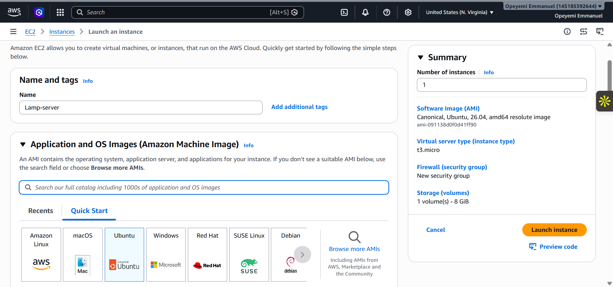
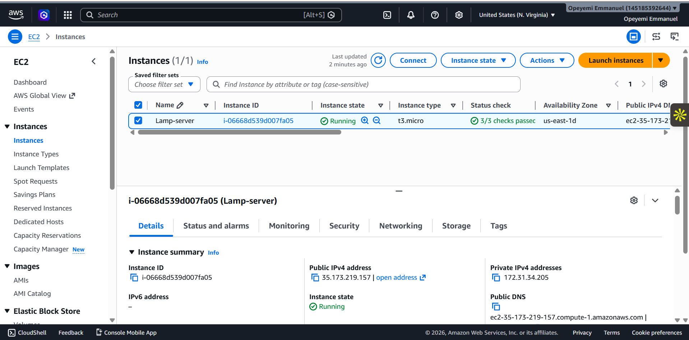

2. An SSH key pair named server-key was generated to enable secure access to the EC2 instance via port 22.
3. The instance’s security group was configured to allow the following inbound traffic rules:
- Allow traffic on port 80 (HTTP) with source from anywhere on the internet.
- Allow traffic on port 443 (HTTPS) with source from anywhere on the internet.
- Allow traffic on port 22 (SSH) with source from any IP address. This is opened by default.

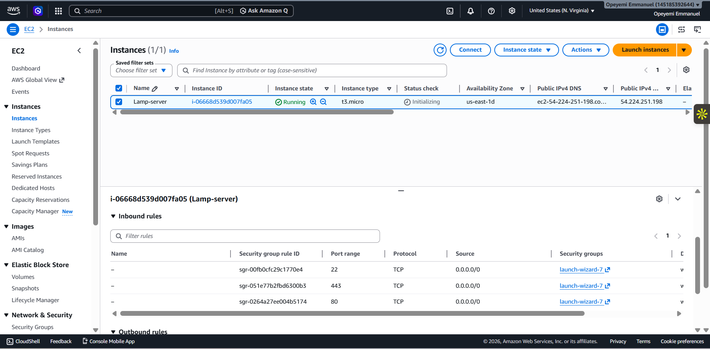

4. The instance was launched using the default VPC and subnet for networking configuration.

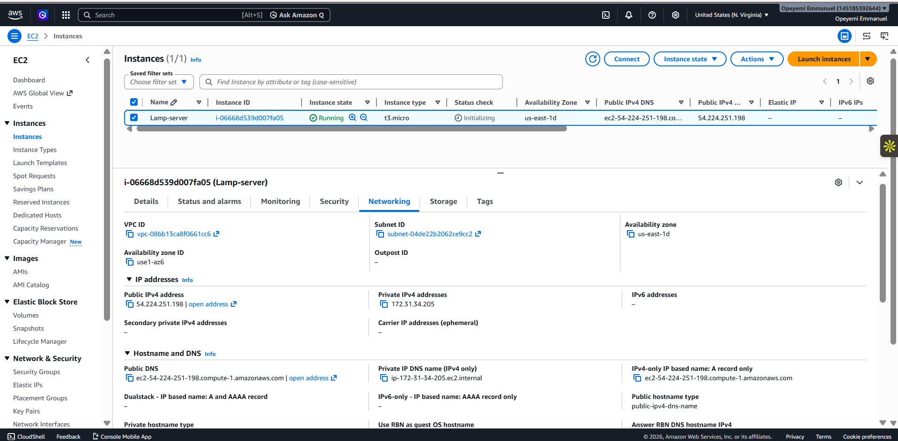

5. The downloaded private SSH key was located, its permissions were modified, and it was used to connect to the instance by running the following command.

```bash
chmod 400 server-key.pem
```
```bash
ssh -i "server-key.pem" ubuntu@54.224.251.198.compute-1.amazonaws.com
```
Where username=ubuntu and public ip address=54.224.251.198
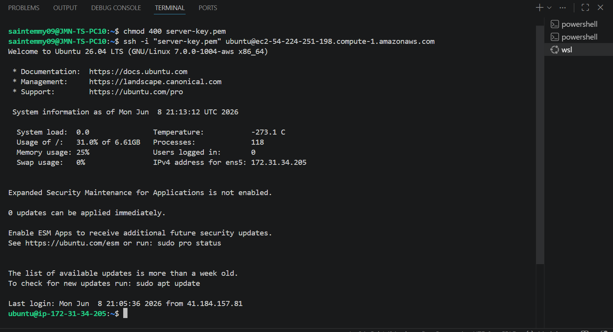


# Step 1 - Install Apache and Update the Firewall

1. Update and upgrade list of packages in package manager
```bash
sudo apt update
sudo apt upgrade -y
```
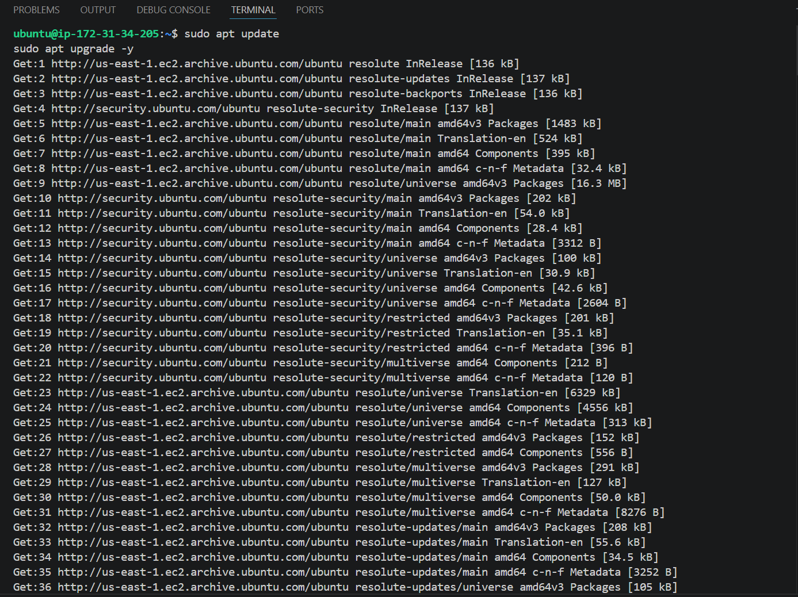

2. The Apache2 package was installed.
```bash
sudo apt install apache2 -y
```
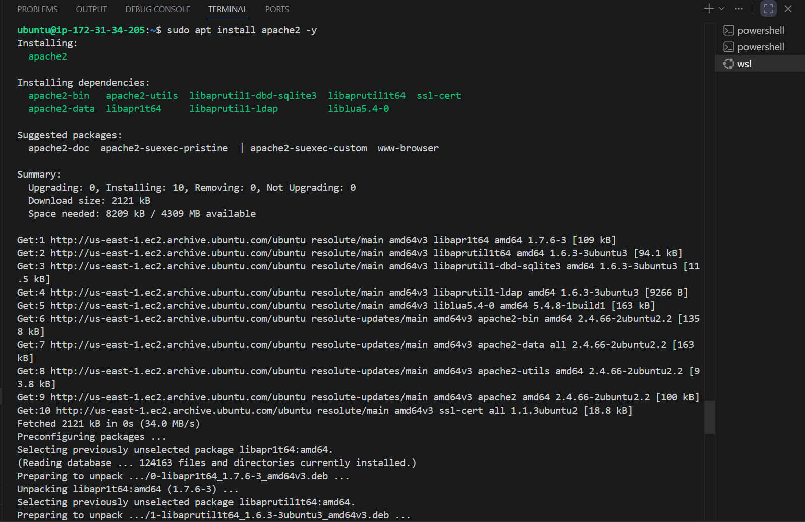

3. Apache was enabled and verified as a running service on the operating system.
```bash
sudo systemctl enable apache2
sudo systemctl status apache2
```
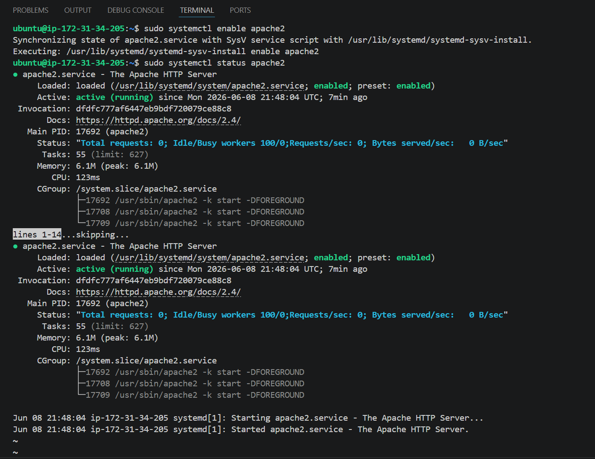

4. The web server is running and can be accessed locally within the Ubuntu shell using the command shown below.
```bash
curl http://localhost:80
OR
curl http://172.31.34.205
```
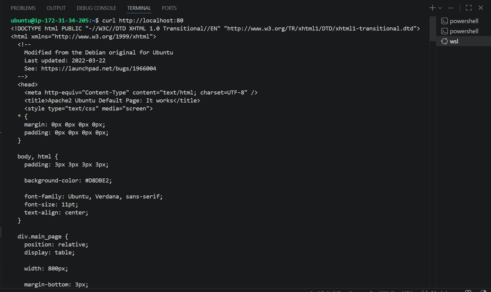

5. The Apache HTTP server was tested using the public IP address to confirm it can respond to requests from the internet via a web browser.
```bash
http://54.224.251.198
```
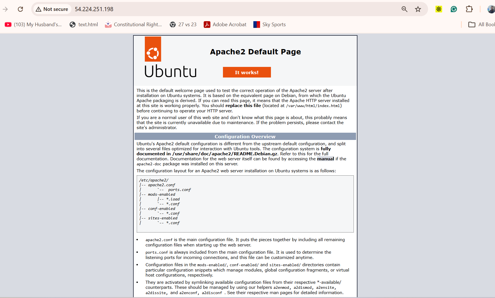

This confirms that the web server is correctly installed and accessible through the firewall.

6. The public IP address can also be retrieved using alternative methods other than the AWS Management Console.
```bash 
curl -s http://54.224.251.198/latest/meta-data/public-ipv4
```
After running the command above, a 401 Unauthorized error was returned.
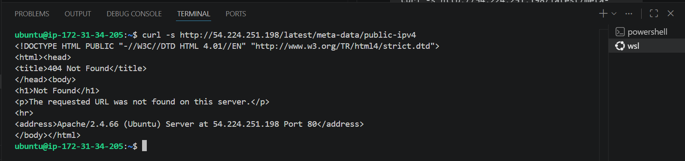

In troubleshooting this error, the following steps were taken from the EC2 instance page on the AWS Console:
- Actions > Instance Settings > Modify instance metadata options.
- Then change the IMDSv2 from Required to Optional.

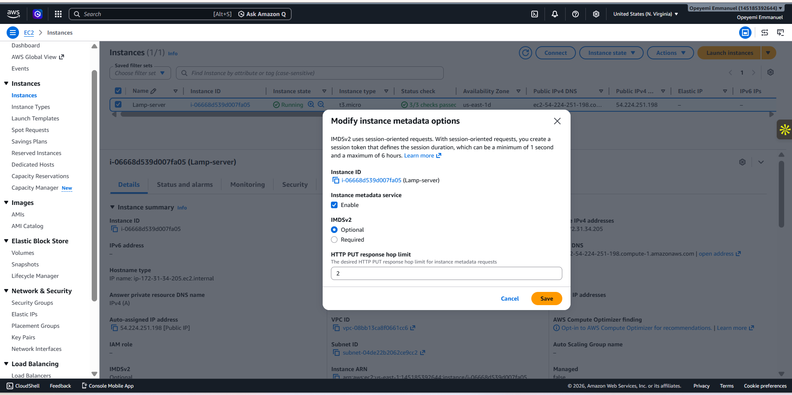

The command was run again, this time there was no error with the public IP address displayed.
```bash
curl -s http://54.224.251.198/latest/meta-data/public-ipv4
```
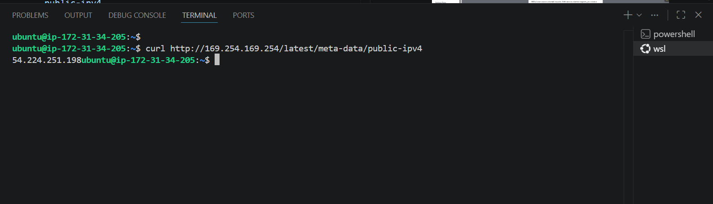

# Step 2: Install MySQL
1. Install a relational database (RDB)

MySQL was installed in this project. It is a popular relational database management system used within PHP environments.

```bash
sudo apt install mysql-server
```
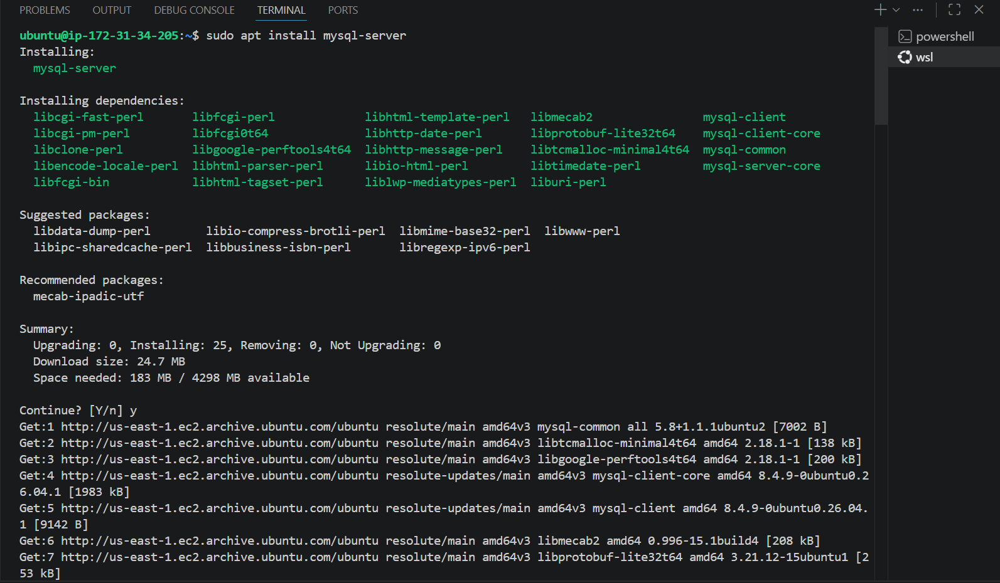

When prompted, the installation was confirmed by entering y and pressing Enter.

2. Enable and confirm that MySQL is running using the commands below.

```bash
sudo systemctl enable --now mysql
sudo systemctl status mysql
```
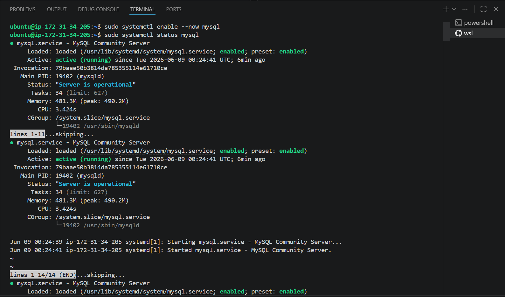

3. Log in to mysql console

```bash
sudo mysql
```
This connects to the MySQL server as the administrative root user, as indicated by the use of sudo when running the command.

4. Set a password for root user using mysql_native_password as default authentication method.

Here, the user's password was defined as "Admin123$"

```bash
ALTER USER 'root'@'localhost' IDENTIFIED WITH mysql_native_password BY 'Admin123$';
```
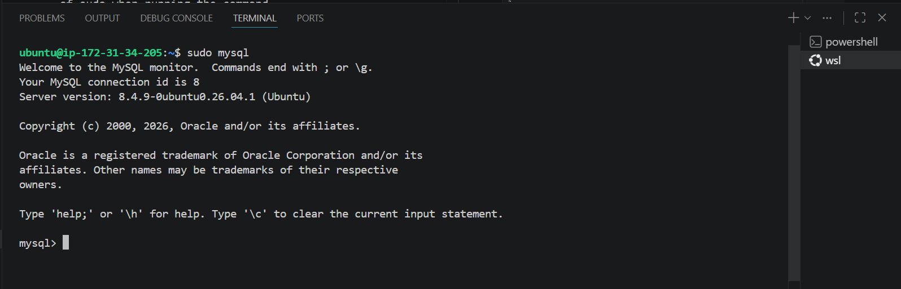

Exit the MySQL shell
```bash
exit
```
5. Run the interactive script to secure MySQL. The security script is pre-installed with MySQL and helps remove insecure default settings while restricting access to the database system.

```bash
sudo mysql_secure_installation
```
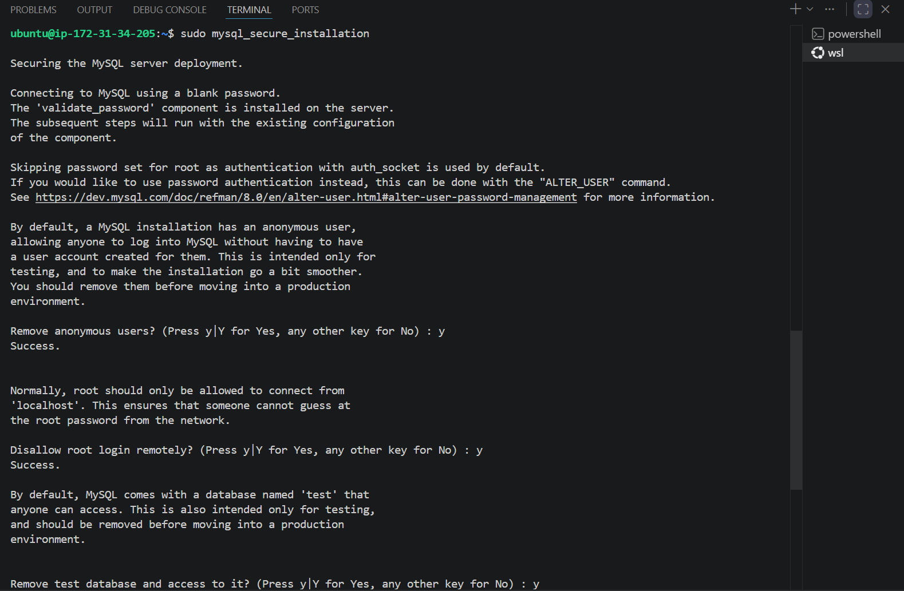

Regardless of whether the VALIDATION PASSWORD PLUGIN is enabled, the server will prompt you to select and confirm a password for the MySQL root user.

6. After changing root user password, log in to MySQL console.

A command prompt for password was noticed after running the command below.

```bash
sudo mysql -p
```
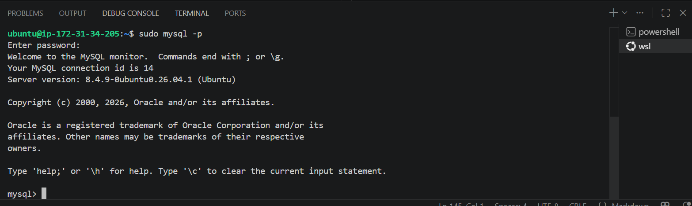

```bash
exit
```

# Step 3 - Install PHP

1. Apache is installed to serve web content, while MySQL is used to store and manage data. PHP processes the code and generates dynamic content for the end user.

The following were installed: 
- php package
- php-mysql, a PHP module that allows PHP to communicate with MySQL-based databases.
- libapache2-mod-php, to enable Apache to handle PHP files.

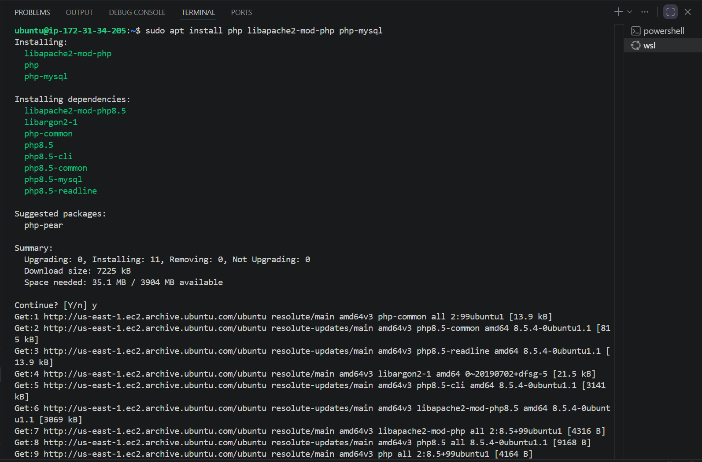

Confirm the php version
```bash
php -v
```

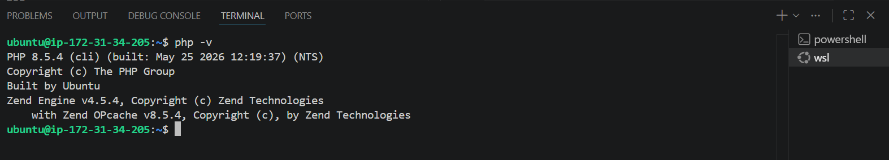

At this point, the LAMP stack has been fully installed and is operational.

To test the setup using a PHP script, it is recommended to configure a proper Apache Virtual Host to host the website files and directories. A virtual host allows multiple websites to run on a single server without being noticeable to users.

# Step 4 - Create a virtual host for the website using Apache

1. The default directory serving the apache default page is /var/www/html. Create your document directory next to the default one.

Created the directory for projectlamp using "mkdir" command

```bash
sudo mkdir /var/www/projectlamp
```
Assign the directory ownership with $USER environment variable which references the current system user.

```bash
sudo chown -R $USER:$USER /var/www/projectlamp
```

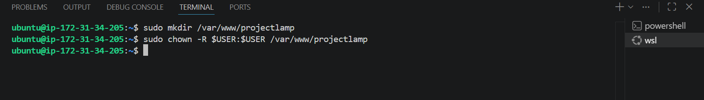

2. Create and open a new configuration file in apache’s “sites-available” directory using vim.

```bash
sudo vim /etc/apache2/sites-available/projectlamp.conf
```

Paste in the bare-bones configuration below:

```bash
<VirtualHost *:80>
  ServerName projectlamp
  ServerAlias www.projectlamp
  ServerAdmin webmaster@localhost
  DocumentRoot /var/www/projectlamp
  ErrorLog ${APACHE_LOG_DIR}/error.log
  CustomLog ${APACHE_LOG_DIR}/access.log combined
</VirtualHost>
```
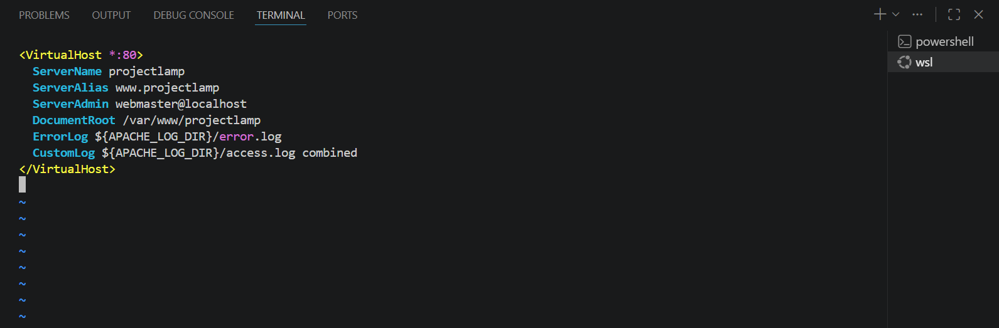

3. Show the new file in sites-available

```bash
sudo ls /etc/apache2/sites-available
```
```bash
Output:
000-default.conf default-ssl.conf projectlamp.conf
```

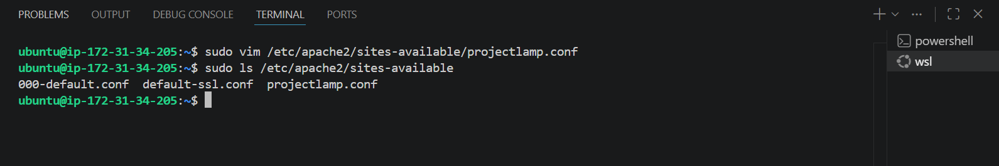

With the VirtualHost configuration, Apache will serve projectlamp using /var/www/projectlamp as the web root directory.

4. Enable the new virtual host

```bash
sudo a2ensite projectlamp
```
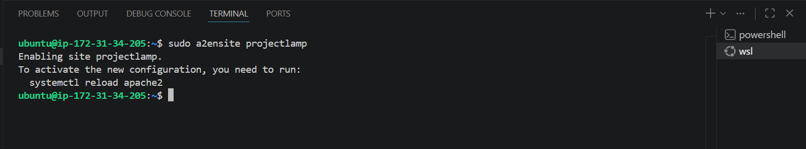

5. Disable apache’s default website.

This is because Apache’s default configuration can override the virtual host if it is not disabled. This step is necessary when a custom domain is not in use.

```bash
sudo a2dissite 000-default
```

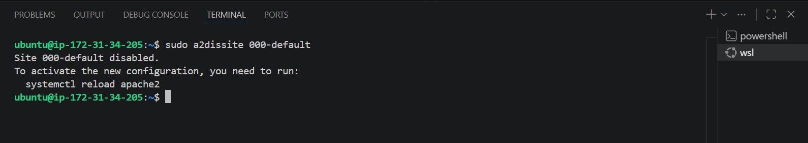

6. Ensure the configuration does not contain syntax error

The command below was used:

```bash
sudo apache2ctl configtest
```
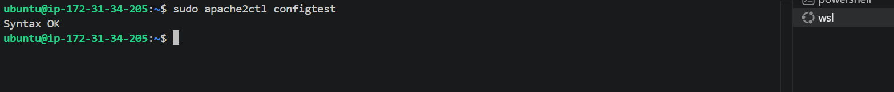

7. Reload apache for changes to take effect.

```bash
sudo systemctl reload apache2
```
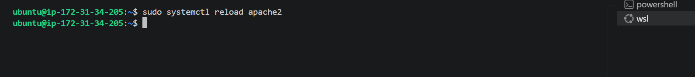

8. The new website is now active, but the web root /var/www/projectlamp is still empty. Create an index.html file in this directory to test that the virtual host is working as expected.

```bash
sudo echo 'Hello LAMP from hostname' $(curl -s http://169.254.169.254/latest/meta-data/public-hostname) 'with public IP' $(curl -s http://169.254.169.254/latest/meta-data/public-ipv4) > /var/www/projectlamp/index.html
```

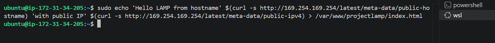

9. Open the website in a browser using the server’s public IP address.
```bash
http://54.224.251.198:80
```

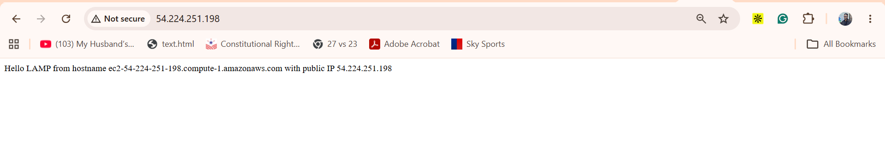

10. Open the website with public dns name (port is optional)

```bash
http://<public-DNS-name>:80
```

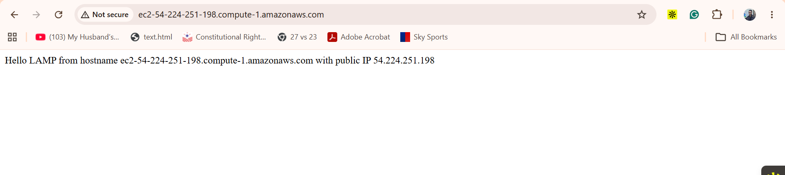

This file can remain in place temporarily as a landing page until an index.php file is created to replace it. After that, the index.html file should be renamed or removed from the document root, as it takes priority over index.php by default.

# Step 5 - Enable PHP on the website

With the default DirectoryIndex setting on Apache, index.html file will always take precedence over index.php file. This is useful for setting up maintenance page in PHP applications, by creating a temporary index.html file containing an informative message for visitors. The index.html then becomes the landing page for the application. Once maintenance is over, the index.html is renamed or removed from the document root bringing back the regular application page. If the behaviour needs to be changed, /etc/apache2/mods-enabled/dir.conf file should be edited and the order in which the index.php file is listed within the DirectoryIndex directive should be changed.

1. Open the dir.conf file with vim to change the behaviour

```bash
sudo vim /etc/apache2/mods-enabled/dir.conf
```

```bash
<IfModule mod_dir.c>
  # Change this:
  # DirectoryIndex index.html index.cgi index.pl index.php index.xhtml index.htm
  # To this:
  DirectoryIndex index.php index.html index.cgi index.pl index.xhtml index.htm
</IfModule>
```

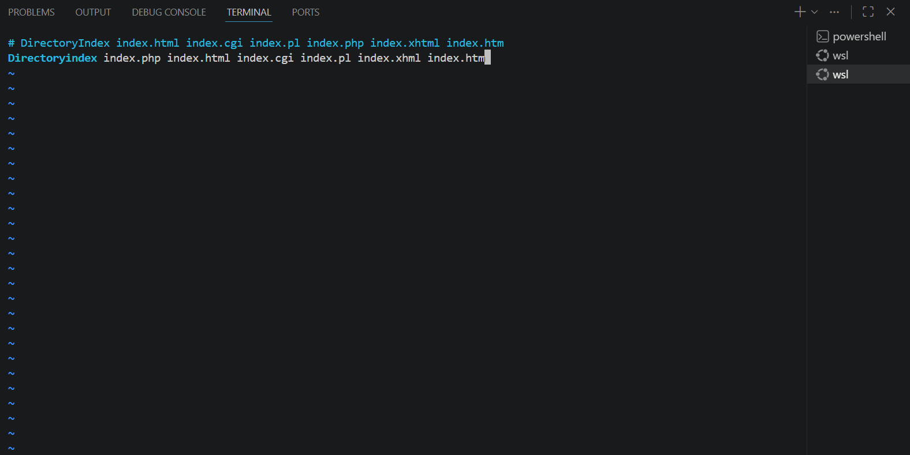

2. Reload Apache
Apache is reloaded so the changes takes effect.

```bash
sudo systemctl reload apache2
```

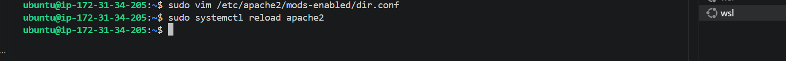

3. Create a php test script to confirm that Apache is able to handle and process requests for PHP files.

A new index.php file was created inside the custom web root folder.

```bash 
vim /var/www/projectlamp/index.php
```

Add the text below in the index.php file

```bash
<?php
phpinfo();
```

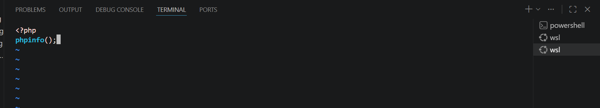

4. Now refresh the page

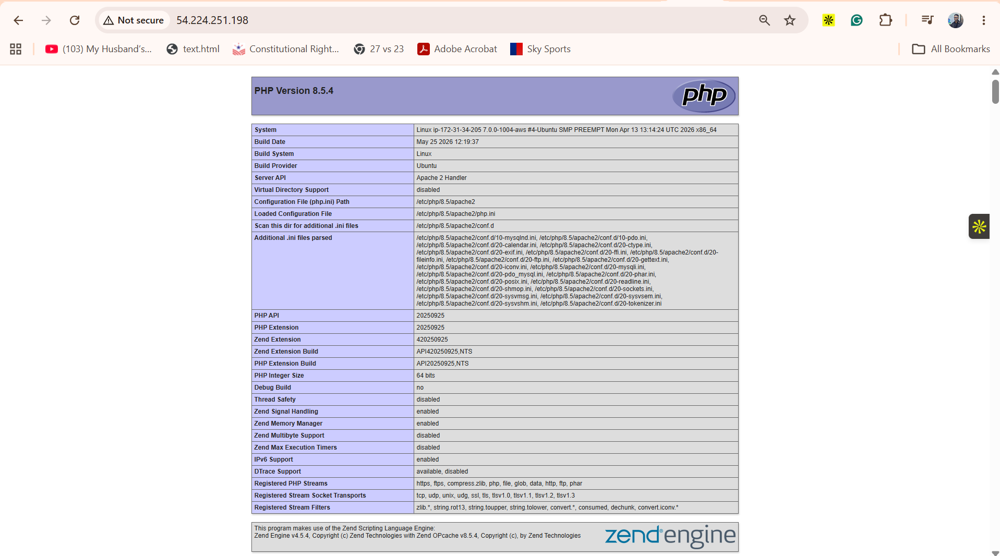

This page provides information about the server from the perspective of PHP. It is useful for debugging and to ensure the settings are being applied correctly.

After reviewing the server information on this page, it is advisable to delete the file created, as it exposes sensitive details about the PHP environment and the Ubuntu server. The file can be recreated later if the information is required again.

```bash
sudo rm /var/www/projectlamp/index.php
```

Conclusion:

The LAMP stack offers a reliable and flexible platform for building and deploying web applications. By following the steps in this documentation, a LAMP environment was successfully set up, configured, and maintained, enabling the development of scalable and efficient web solutions.


