# IMPLEMENT A CLIENT-SERVER ARCHITECTURE USING MYSQL DATABASE MANAGEMENT. 

Client-server architecture is a network model in which two or more computers communicate by exchanging requests and responses over a network. In this model, the computer that initiates a request is called the client, while the computer that processes the request and provides the requested service is called the server. 


# To demonstrate a basic client-server architecture using the MySQL relational database management system (RDBMS), the following steps were executed:

1. Create and configure two Linux-based virtual servers (EC2 instances) on AWS.

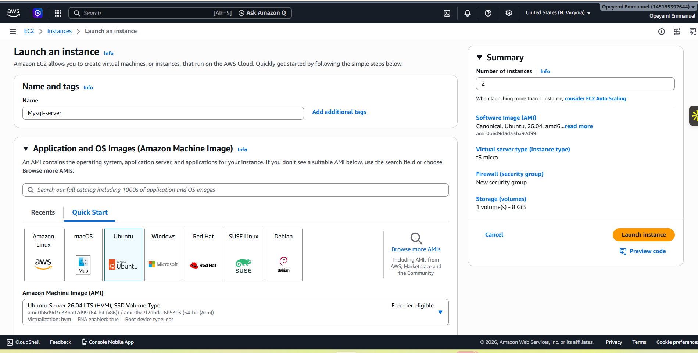
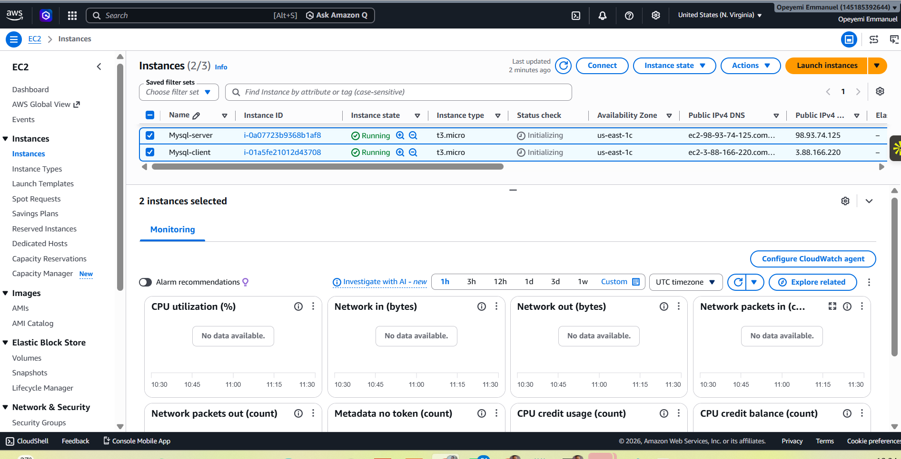

Establish SSH Connections to the MySQL Server and MySQL Client EC2 instances. 
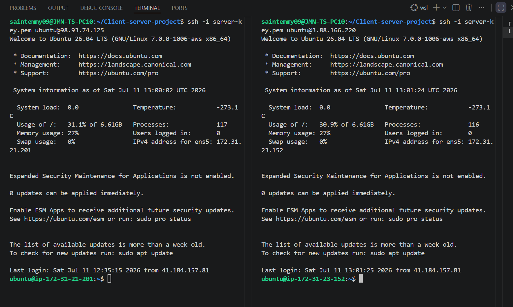

2. Next Step: Install MySQL Server 
 Update the package manager 
```bash
sudo apt update
```
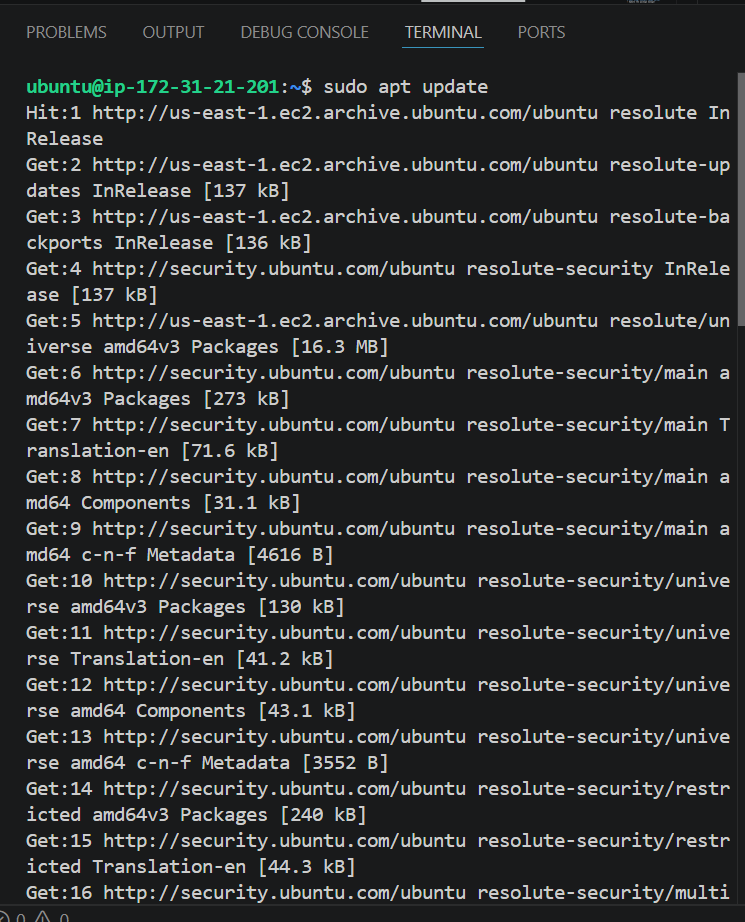

- Install MySQL server
```bash 
sudo apt install mysql-server -y
```
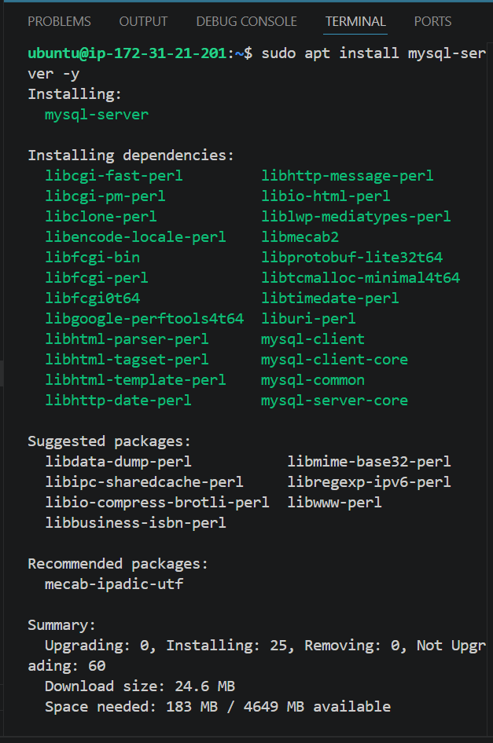

3. Install the MySQL Client on the client EC2 instance.
```bash
sudo apt update
```
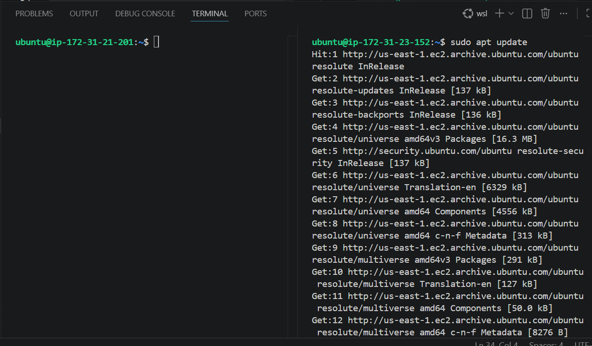

```bash
sudo apt install mysql-client -y
```
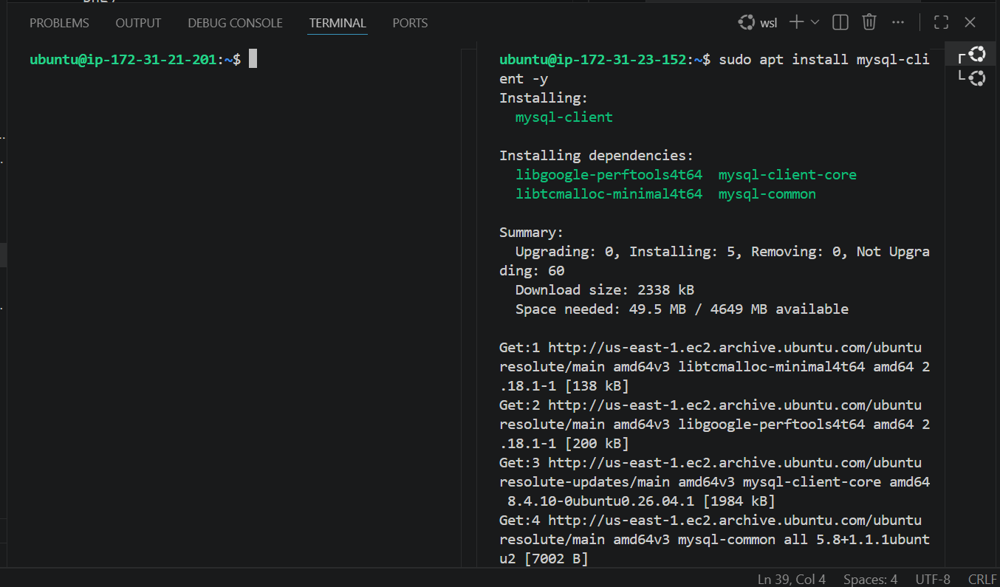
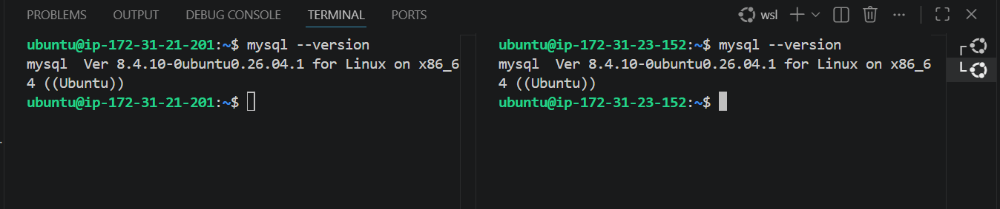

4. Configure the MySQL Server Security Group to Allow Inbound Traffic on Port 3306.

Open port 3306 in the MySQL Server security group to allow inbound MySQL traffic.

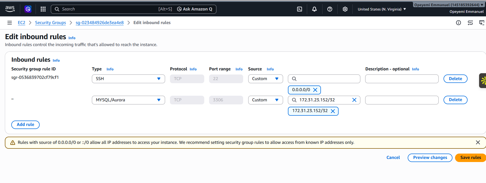
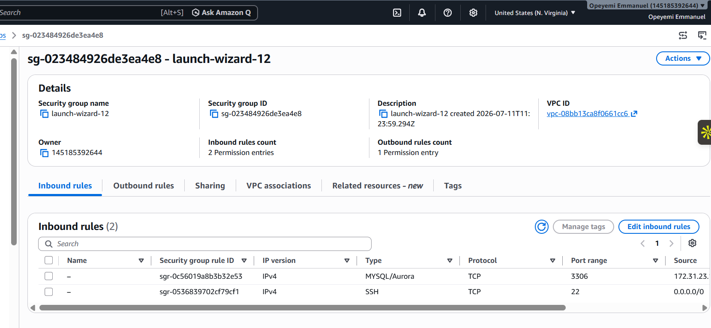

5. Configure the MySQL Server to Allow Connections from the MySQL Client EC2 Instance.

```bash
sudo vi /etc/mysql/mysql.conf.d/mysqld.cnf
```
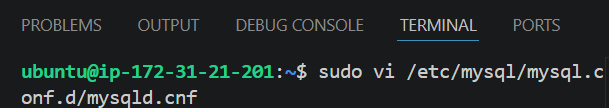
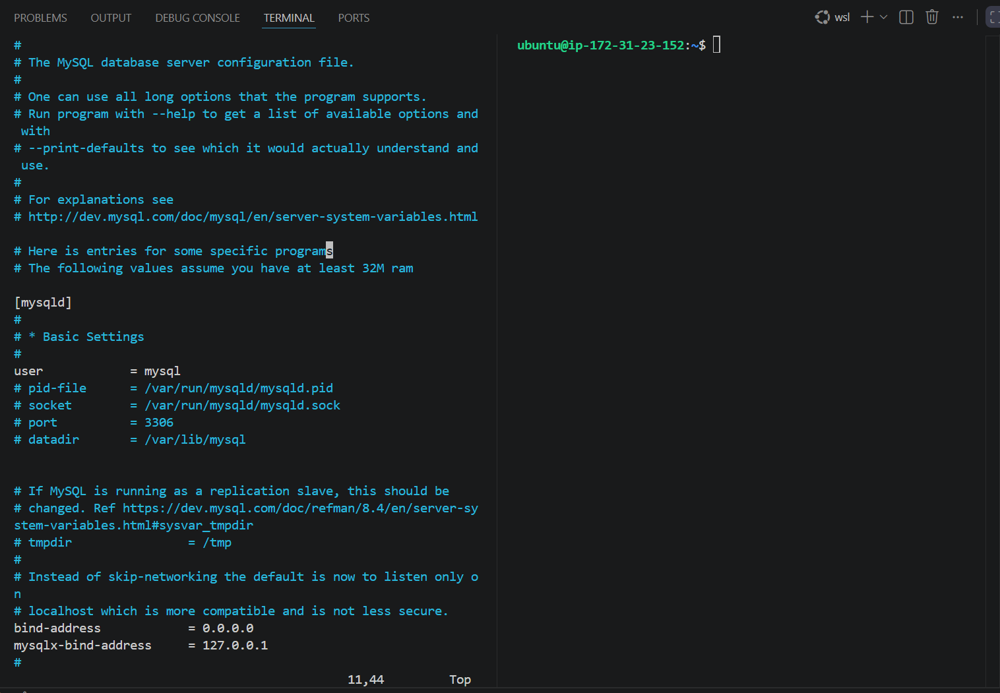
 
6. Restart MySQL 
 ```bash
 sudo systemctl restart mysql
 ```
 Verify MySQL is listening on all interfaces
 ```bash
 sudo ss -tlnp | grep 3306
 ```
 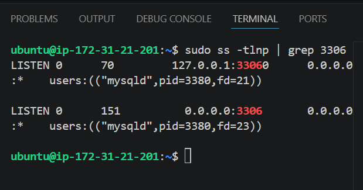

7. Create a MySQL User with Remote Access Privileges.

MySQL is now listening on all network interfaces. Since the root user cannot typically log in remotely for security reasons, create a dedicated user that is permitted to connect from the MySQL Client EC2 instance.
```bash
sudo mysql
```
```bash
CREATE USER 'client_saintemmy'@'172.31.23.152' IDENTIFIED BY '!';
GRANT ALL PRIVILEGES ON *.* TO 'client_saintemmy'@'172.31.23.152';
FLUSH PRIVILEGES;
EXIT;
```

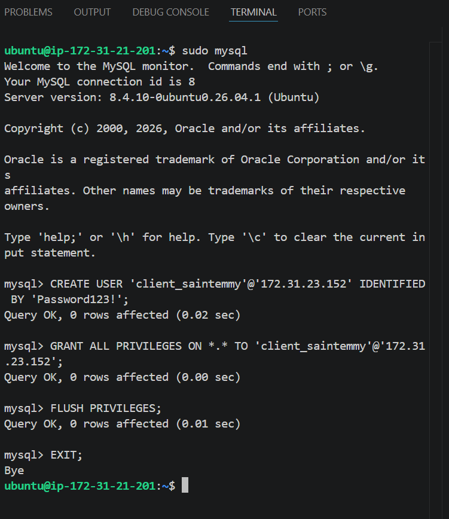

Connect from mysql client (172.31.23.152)
```bash
mysql -h 172.31.21.201 -u client_saintemmy -p
```
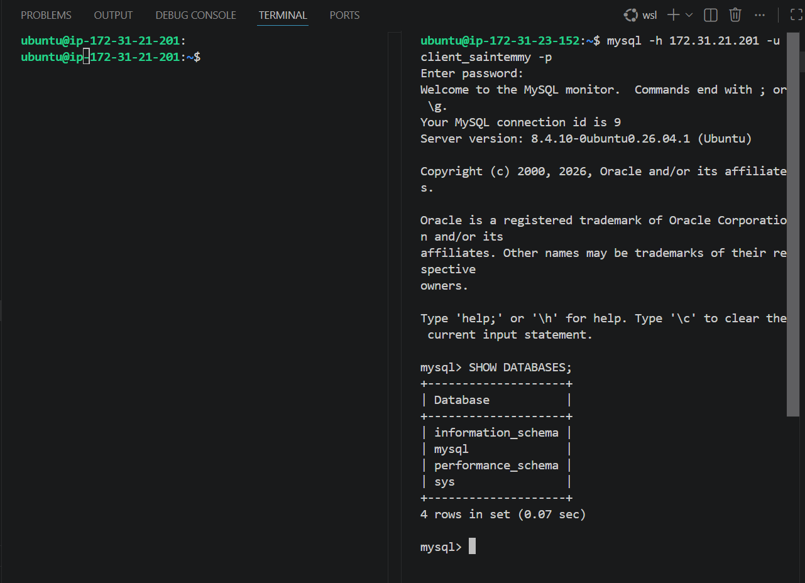

Conclusion: 

This project successfully demonstrated a basic client-server architecture using MySQL on two Amazon EC2 instances. After configuring the MySQL server for remote access and creating the appropriate user permissions, the MySQL Client EC2 instance was able to connect to and communicate with the MySQL Server, confirming that the client-server setup functioned as expected.