# LOAD BALANCER SOLUTION WITH APACHE

As user demand increases, a web application must be able to handle a growing number of requests without compromising performance or availability. Relying on a single web server can quickly become a limitation, making it necessary to distribute traffic across multiple servers.

This project demonstrates the implementation of an Apache Load Balancer on AWS, which acts as a single entry point for client requests and intelligently distributes traffic across multiple backend web servers. The solution improves scalability, availability, and fault tolerance while also demonstrating local DNS name resolution using the ```/etc/hosts``` file to simplify backend server management.

# Solution Architecture

The diagram below illustrates the architecture implemented in this project. Incoming client requests are routed through an Apache Load Balancer, which distributes traffic across multiple backend web servers. The web servers communicate with a shared MySQL database and NFS server, creating a scalable, highly available, and fault-tolerant infrastructure.

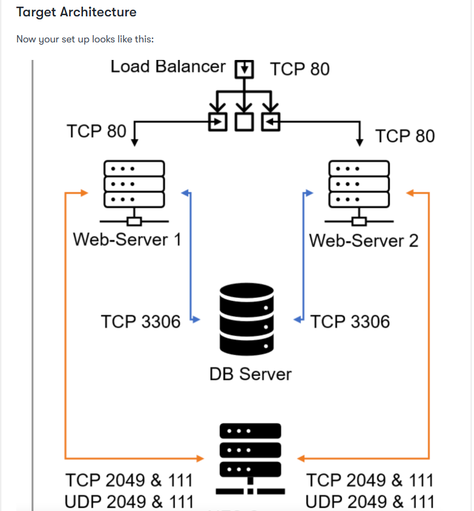

# Goal
Configure and deploy an Apache Load Balancer on a dedicated Ubuntu EC2 instance to distribute incoming requests across multiple backend web servers.

# Prerequisites 

Before implementing the load balancer, the following infrastructure had already been deployed:

- Two RHEL8 Web Servers
- One MySQL DB Server (based on Ubuntu 24.04)
- One RHEL8 NFS Server

# Step 1: Configure Apache as a Load Balancer

1. Create an Ubuntu Server 20.04 EC2 instance and name it `Apache-lb`

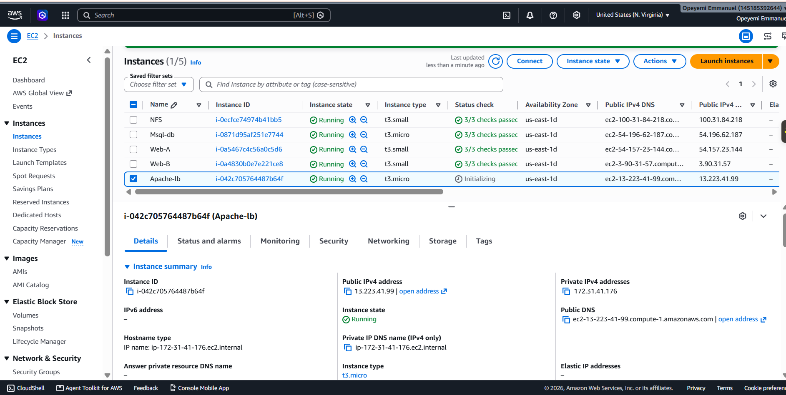

2. Open TCP port 80 on `Apache-lb` by creating an Inbound Rule in Security Group.

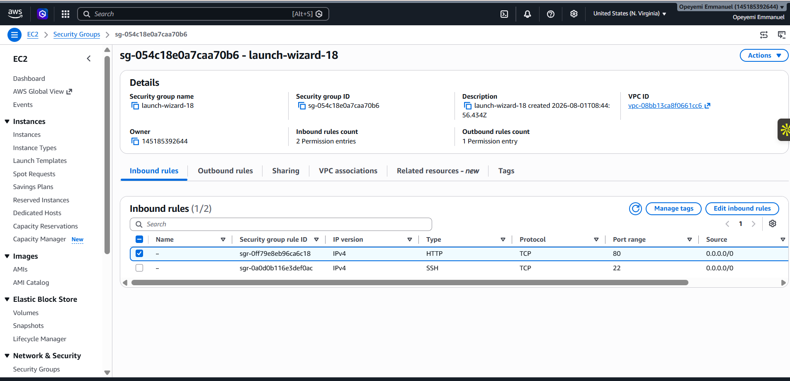

3. Install Apache Load Balancer on `Apache-lb` server and configure it to point traffic coming to LB to both Web Servers:

```bash
sudo apt update
sudo apt install apache2 -y
sudo apt-get install libxml2-dev

sudo a2enmod rewrite
sudo a2enmod proxy
sudo a2enmod proxy_balancer
sudo a2enmod proxy_http
sudo a2enmod headers
sudo a2enmod lbmethod_bytraffic

sudo systemctl restart apache2
sudo systemctl status apache2
```

- Update package manager 
```bash
sudo apt update
```
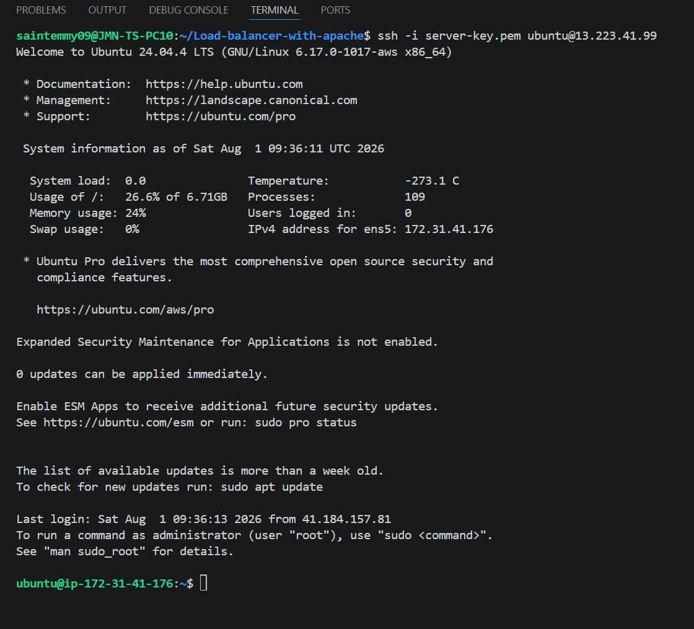
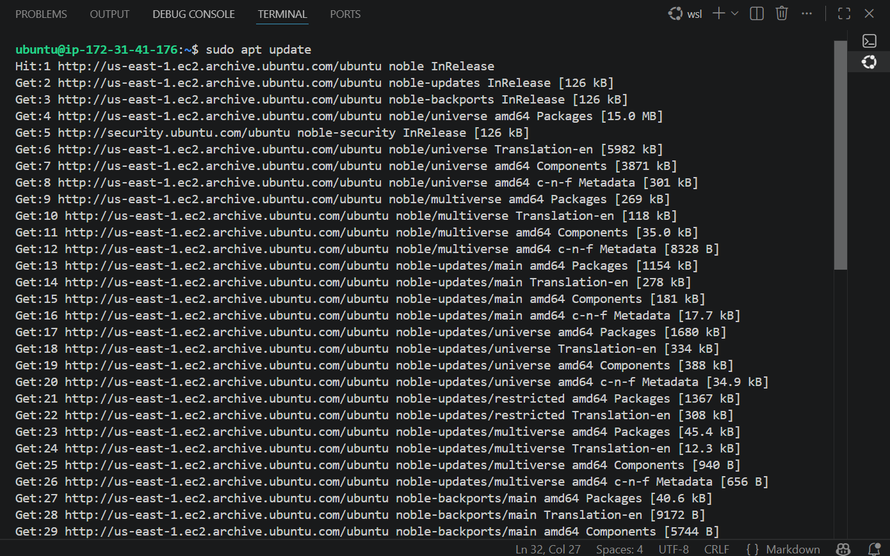

Install Apache 
```bash 
sudo apt install apache2 -y
```
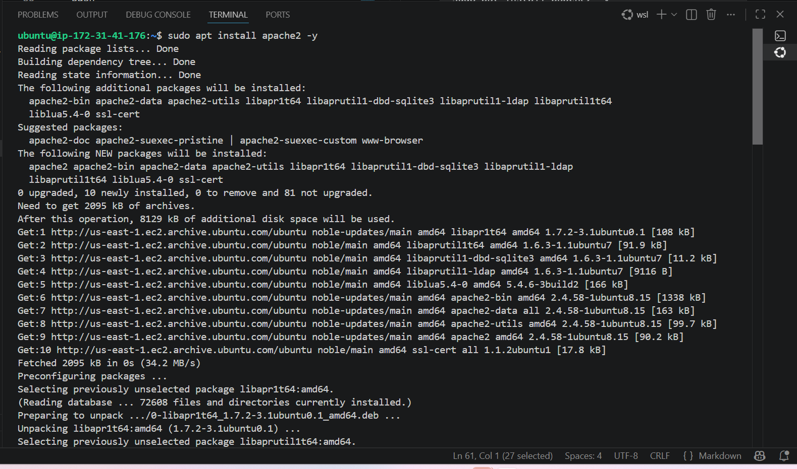
```bash
sudo apt-get install libxml2-dev
```
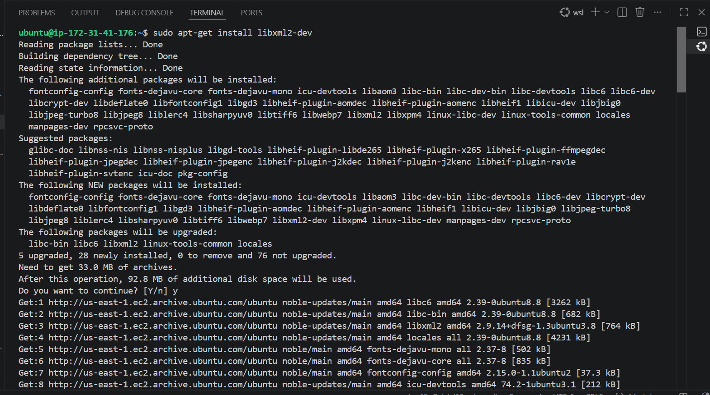

Enable the following modules 
```bash
sudo a2enmod rewrite
sudo a2enmod proxy
sudo a2enmod proxy_balancer
sudo a2enmod proxy_http
sudo a2enmod headers
sudo a2enmod lbmethod_bytraffic
```
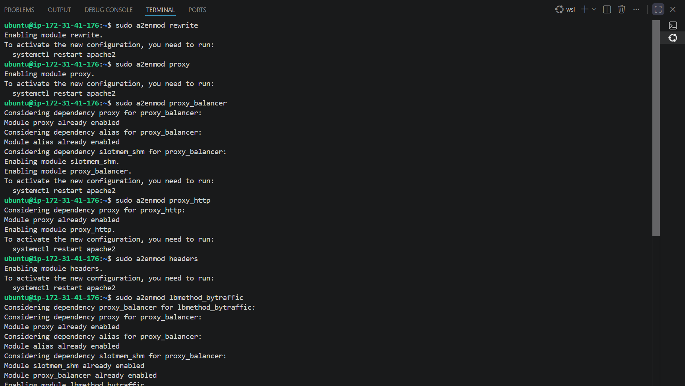

Restart Apache service and confirm its running.
```bash
sudo systemctl restart apache2
sudo systemctl status apache2
```
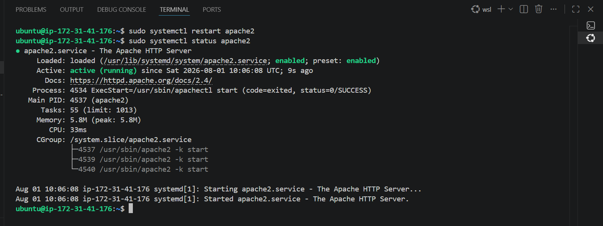

**Configure load balancer**

i. Open the file 000-default.conf in sites-available
```bash
sudo vi /etc/apache2/sites-available/000-default.conf
```

Add this configuration into the section <VirtualHost *:80>

```bash
<Proxy "balancer://mycluster">
    BalancerMember http://172.31.36.90:80 loadfactor=5 timeout=1
    BalancerMember http://172.31.47.217:80 loadfactor=5 timeout=1
    ProxySet lbmethod=bytraffic
    # ProxySet lbmethod=byrequests
</Proxy>

ProxyPreserveHost On
ProxyPass / balancer://mycluster/
ProxyPassReverse / balancer://mycluster/
```
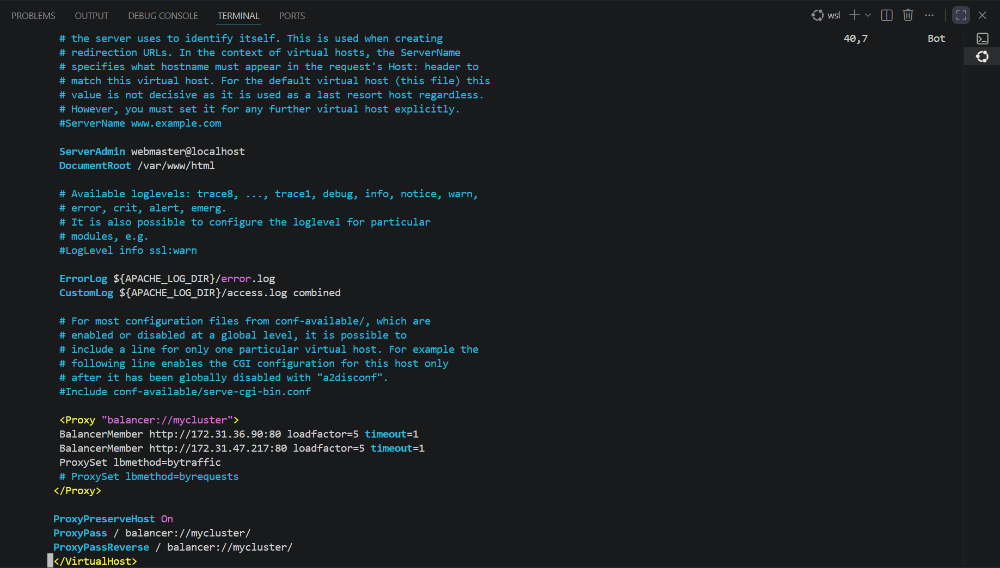

Restart Apache.
```bash
sudo systemctl restart apache2
sudo systemctl status apache2
```
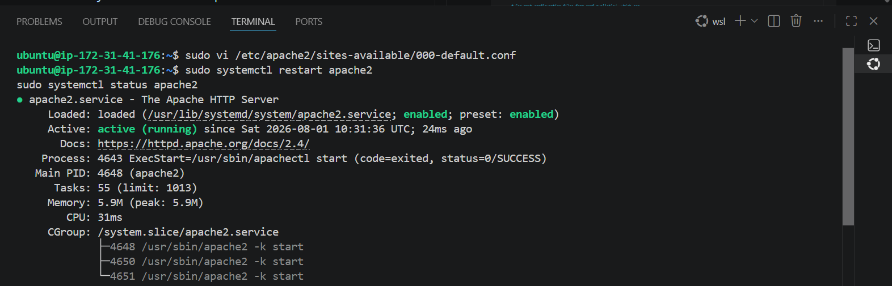

**Verify the Load Balancer Configuration** 

Access the website using the Load Balancer's public IP address ```13.223.41.99``` or from a browser. 

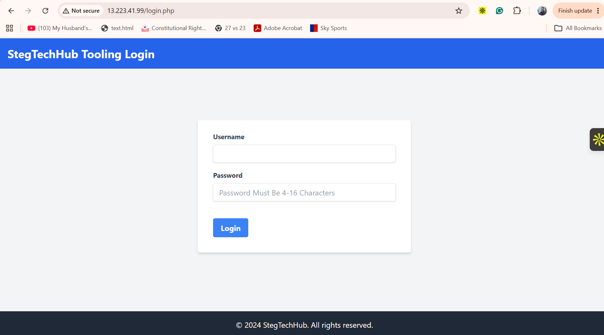


# Step 2: Separate Web Server Logs and Verify Load Balancing. 
**Note:** If in the previous project, /var/log/httpd was mounted from the Web Server to the NFS Server, unmount them and ensure that each Web Servers has its own log directory.

Confirm the Web Server's log directory is mounted to NFS...
```bash
mount | grep httpd
```
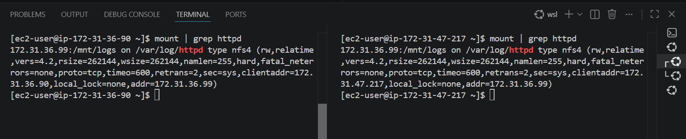

**Unmount the shared NFS logs directory**
```bash
sudo umount -f /var/log/httpd
```
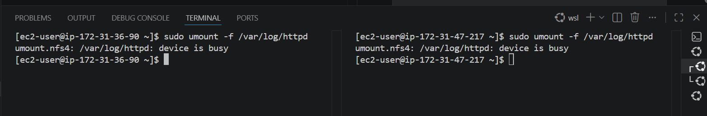

Apache is busy and needs to be stopped first. 
```bash
sudo systemctl stop httpd
```
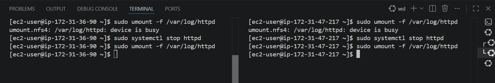
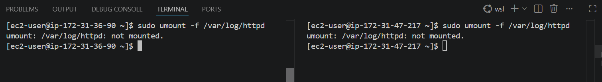

Confirm that `/var/log/httpd` is no longer mounted from NFS on both web servers:

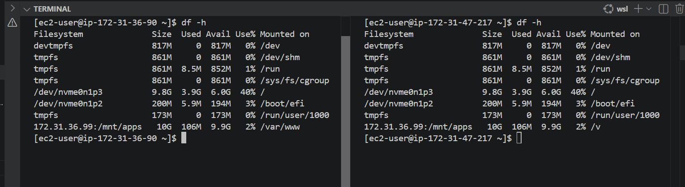

Start Apache on both servers and confirm they're running. 
```bash
sudo systemctl start httpd
sudo systemctl status httpd
```
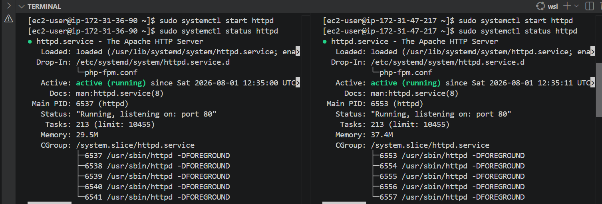

### Verify Load Balancer

To confirm that traffic is actually being distributed between both web servers (and not just served by one), run the following command on Web-server1 and Web-server2 to watch their access logs in real time:

```bash
sudo tail -f /var/log/httpd/access_log
```

With both terminals actively tailing their logs, refresh the Load Balancer's URL several times in a browser:

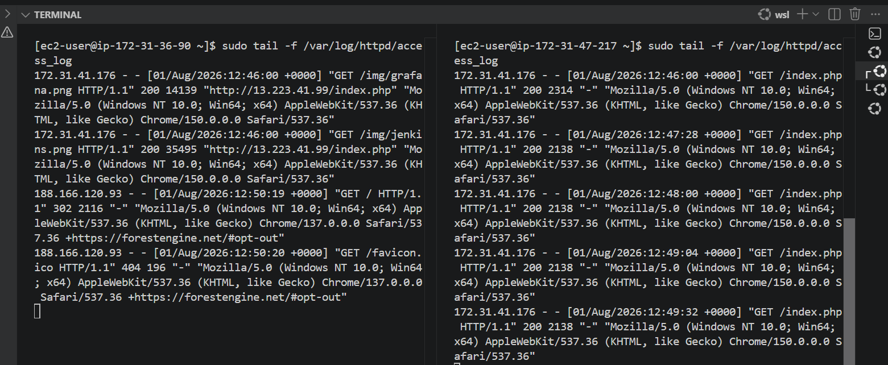

# Step 3: Configure Local DNS Name Resolution.

**Note:** Switching between IP addresses can get tedious with multiple servers. A simple (though not very scalable) fix is local domain name resolution via the `/etc/hosts` file — mapping IPs to friendly names for the LB.

Open the /etc/hosts file.
```bash 
sudo vi /etc/hosts
```
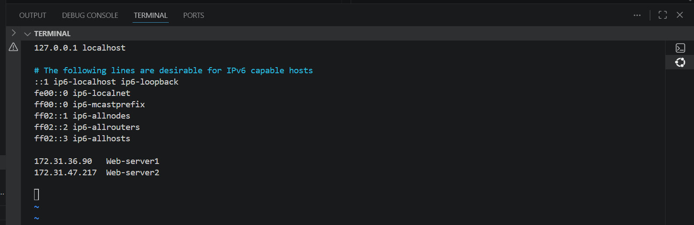

Update the Apache-lb config file to use these names instead of raw IPs:
```bash
sudo vi /etc/apache2/sites-available/000-default.conf
```
```bash
BalancerMember http://Web-server1:80 loadfactor=5 timeout=1
BalancerMember http://Web-server2:80 loadfactor=5 timeout=1
```
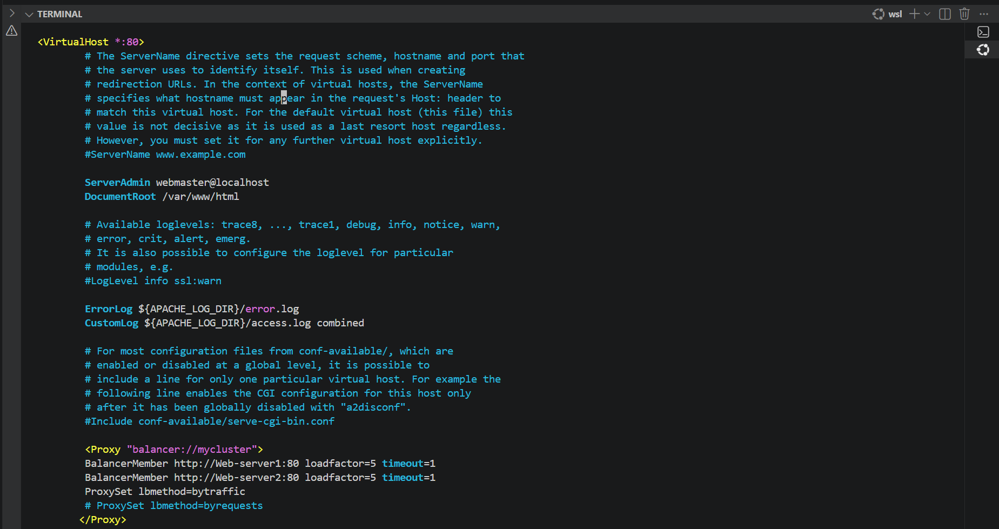

Verify that the hostnames resolve correctly and both web servers respond as expected:

```bash
curl http://Web-server1
curl http://Web-server2
```
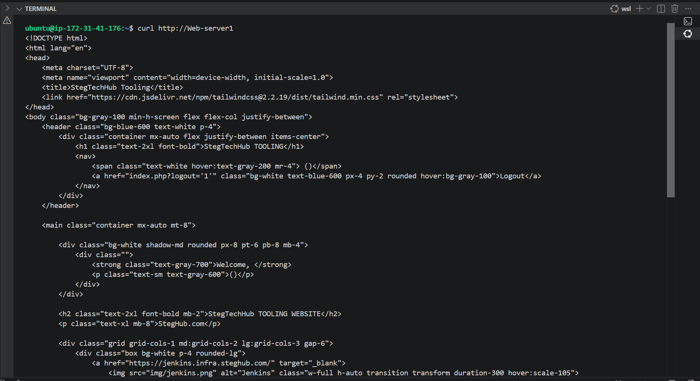
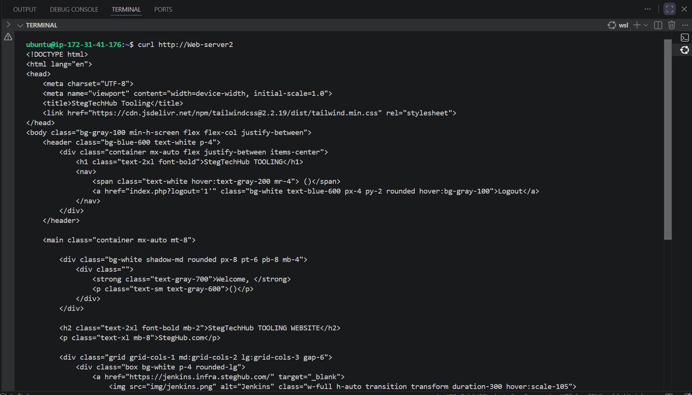

Verify that the load balancer is still correctly serving the site end-to-end through its public IP:

```bash
http://13.223.41.99/index.php
```
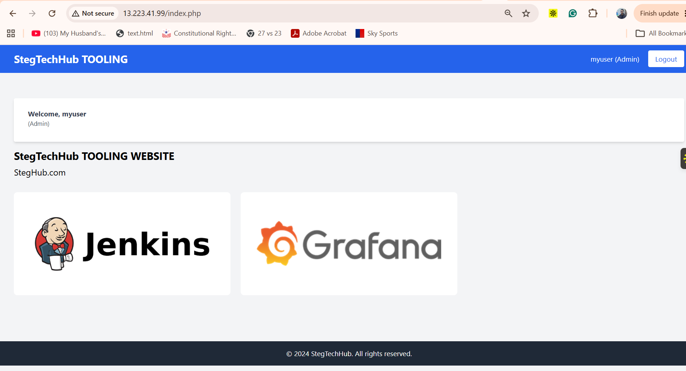

**Conclusion:**

This project successfully implemented an Apache-based Load Balancer to distribute client requests across multiple web servers, providing a single entry point for users while improving the scalability, availability, and fault tolerance of the application. It also demonstrated how load balancing, independent web server logging, and local DNS name resolution contribute to a more manageable and resilient infrastructure. Overall, the project provided practical experience in designing and deploying a highly available web environment on AWS.


