 # Ansible Dynamic Assignments (Include) and Community Roles

Ansible supports two ways of pulling playbooks, tasks and variables into a configuration: static assignments with the `import` module, and dynamic assignments with the `include` module.

With `import`, all statements are pre-processed when the playbook is parsed. If anything changes during execution, the change is not picked up. With `include`, statements are processed only while the playbook is running, so changes encountered during execution are taken into account.

Static assignments are generally recommended for playbooks because they are more reliable and easier to debug. Dynamic assignments are harder to troubleshoot because of their nature, but they work well for environment-specific variables, which is how they are applied here.

The topic also covers community roles: ready-made, production-tested roles built by the open source community and shared through Ansible Galaxy. Reusing them, such as a MySQL role for the database layer, saves the effort of writing common configuration from scratch.

### Introducing Dynamic Assignments into the Structure.

1. In the ansible-config-mgt GitHub repo, create a new branch called dynamic-assignments.

```bash
git checkout -b dynamic-assignments
```
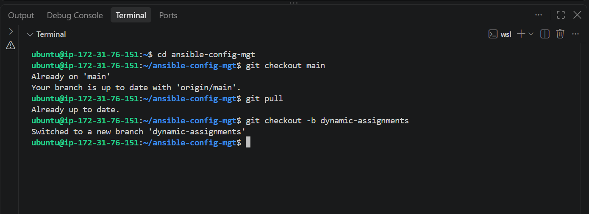

2. Create a folder named dynamic-assignments, and inside it a file named env-vars.yml.

```bash 
mkdir dynamic-assignments
touch dynamic-assignments/env-vars.yml
```
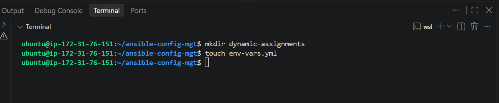

3. Create an env-vars folder in the repo, with a YAML file for each environment: dev.yml, stage.yml, uat.yml and prod.yml. These hold the environment-specific variable values (server names, IP addresses and so on).

```bash
mkdir env-vars
cd env-vars
touch dev.yml stage.yml uat.yml prod.yml
```
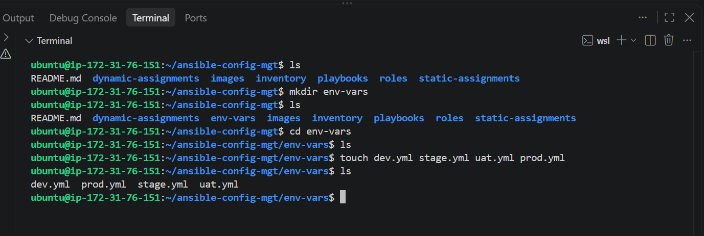

4. Paste the include_vars task into env-vars.yml

```bash 
---
- name: collate variables from env specific file, if it exists
  hosts: all
  tasks:
    - name: looping through list of available files
      include_vars: "{{ item }}"
      with_first_found:
        - files:
            - "{{ inventory_file | basename }}"
            - dev.yml
            - stage.yml
            - prod.yml
            - uat.yml
          paths:
            - "{{ playbook_dir }}/../env-vars"
      tags:
        - always
```
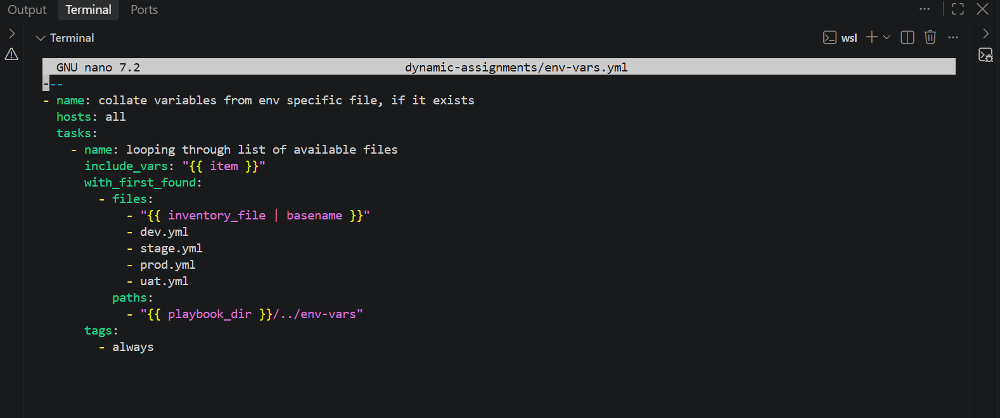

5. Update site.yml file to make use of the dynamic assignment

```bash
---
- name: Include dynamic variables
  import_playbook: ../dynamic-assignments/env-vars.yml
  tags:
    - always

- import_playbook: ../static-assignments/common.yml

- name: Webserver assignment
  import_playbook: ../static-assignments/uat-webservers.yml
```
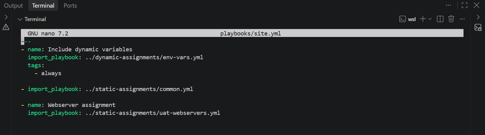


## Community Roles 

Community roles are production-ready roles developed by open source engineers and designed to work across most Linux distributions. They are downloaded through Ansible Galaxy, so a ready-made role can be installed and used straight away.
The role used here is the MySQL role developed by ```geerlingguy```. It installs the MySQL package, creates a database and configures users, which covers the database layer of the Tooling website.
To keep the GitHub repository in a known state after installing a new role, the ansible-config-mgt directory should be committed and pushed. Git needs to be installed and configured on the Jenkins-Ansible server. 

Download Mysql Ansible Role 

- We will be using a MySQL role developed by ```geerlingguy```  

Set up the repository and create the roles-feature branch

```bash
git init
git pull https://github.com/Saintemmy09/ansible-config-mgt.git
git remote add origin https://github.com/Saintemmy09/ansible-config-mgt.git
git branch roles-feature
git switch roles-feature
```

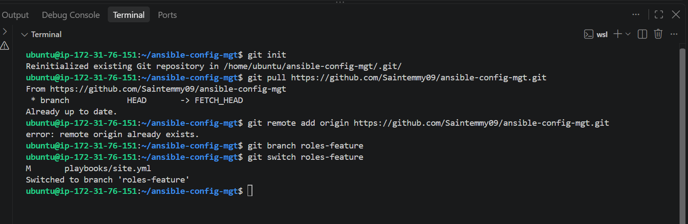

6. Inside the roles directory, create your new MySQL role with ```ansible-galaxy``` ```install geerlingguy.mysql``` and rename the folder to mysql. 

```bash
cd roles
ansible-galaxy install geerlingguy.mysql
```
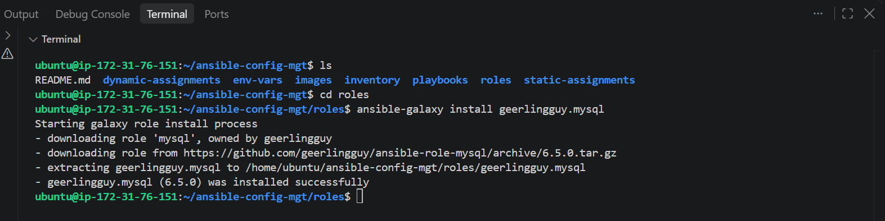

7. Rename the folder```geerlingguy.mysql``` to ```mysql```
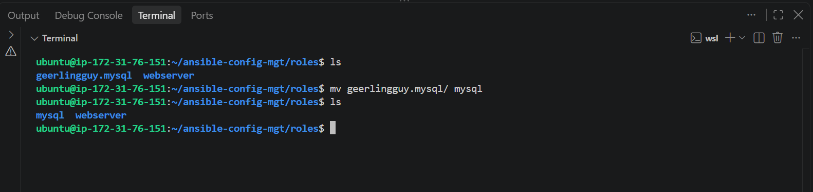

8. Edit roles configuration to use correct credentials for MySQL required for the tooling website.
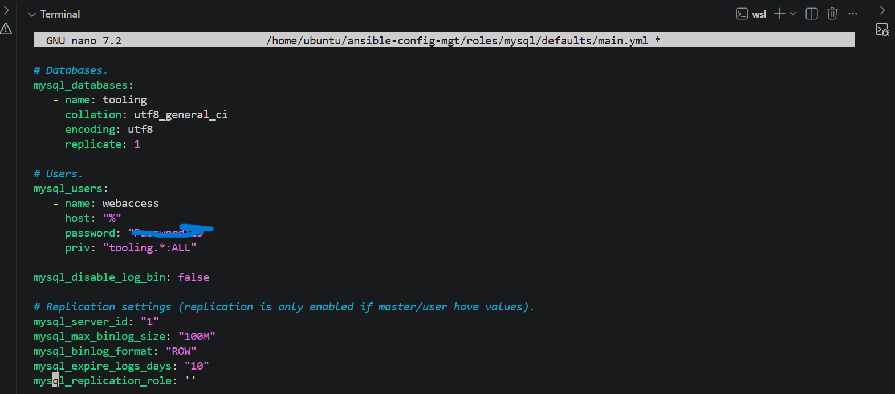

9. Upload the changes 

```bash
git add .
git commit -m "Commit new role files into GitHub"
git push --set-upstream origin roles-feature
```
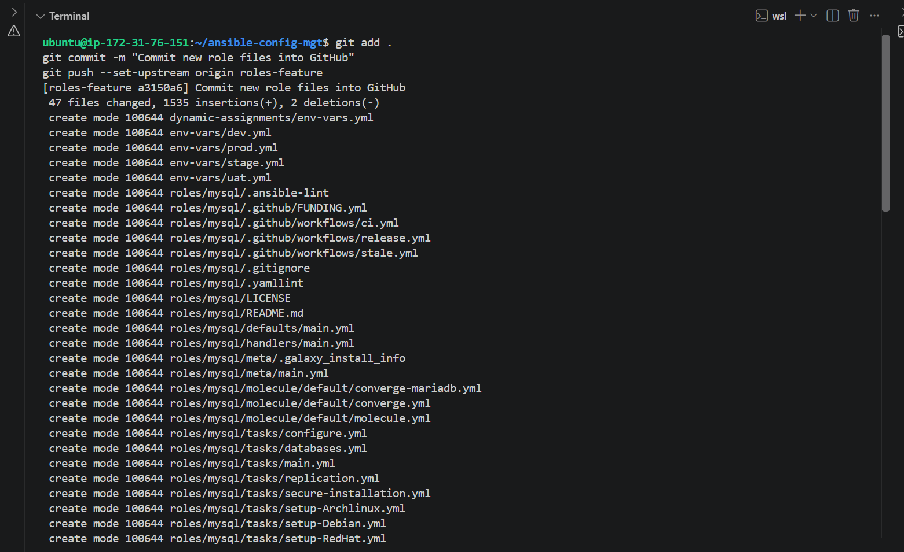

## Load Balancer Roles                           

We need to be able to choose Nginx or Apache as the load balancer, so there needs to be a role for each. 

10. Create the branch for loadbalancer roles work.

```bash
git checkout -b loadbalancer-roles
```
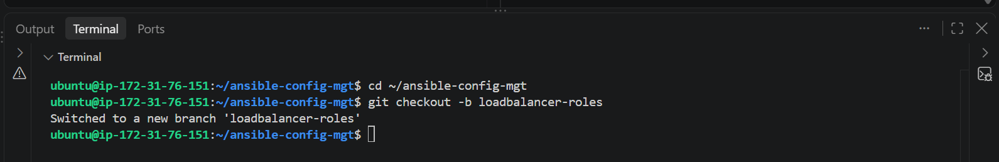

11. Install the Nginx and Apache roles into roles. 

```bash
cd roles
ansible-galaxy install geerlingguy.nginx
ansible-galaxy install geerlingguy.apache
```
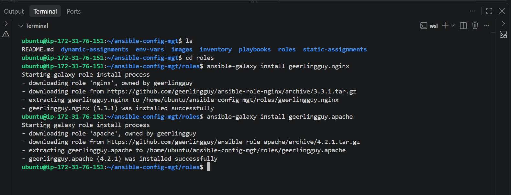

12. Rename the folders
```bash
mv geerlingguy.nginx nginx
mv geerlingguy.apache apache
```
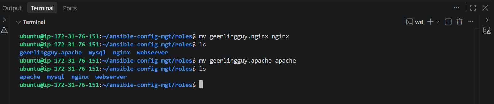

13. Add the load balancer toggles to `nginx/defaults/main.yml`
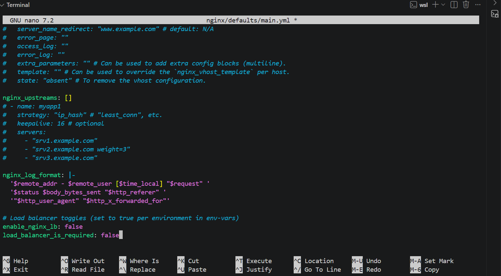

14. Add the load balancer toggles to `apache/defaults/main.yml`
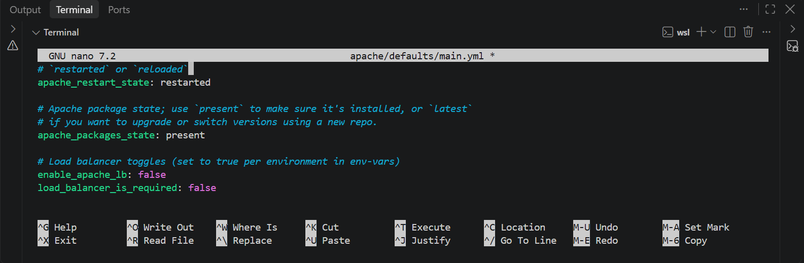

15. Create a loadbalancers.yml playbook in static-assignments that applies the Nginx or Apache role to the lb hosts

```bash
nano static-assignments/loadbalancers.yml

- hosts: lb
  become: true
  roles:
    - { role: nginx, when: enable_nginx_lb and load_balancer_is_required }
    - { role: apache, when: enable_apache_lb and load_balancer_is_required }
```
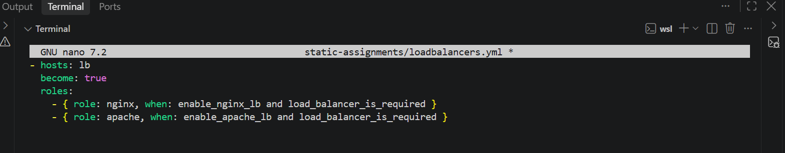

16. Update the ```site.yml``` file with the loadbalancers.yml assignment 

```bash
nano playbooks/site.yml

---
- name: Include dynamic variables
  import_playbook: ../dynamic-assignments/env-vars.yml
  tags:
    - always

- import_playbook: ../static-assignments/common.yml

- name: Webserver assignment
  import_playbook: ../static-assignments/uat-webservers.yml

- name: Loadbalancers assignment
  import_playbook: ../static-assignments/loadbalancers.yml
  when: load_balancer_is_required

```
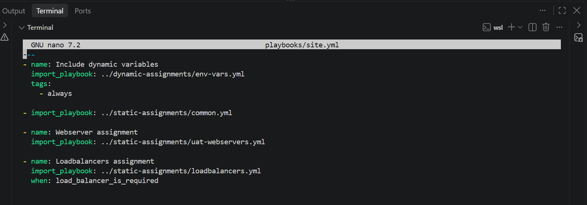

17. Update the ```env-vars/uat.yml``` file with ```enable_nginx_lb: true``` to activate the Nginx load balancer for the UAT environment, while Apache stays disabled by its default value. 

```bash 
nano env-vars/uat.yml

enable_nginx_lb: true
load_balancer_is_required: true
```
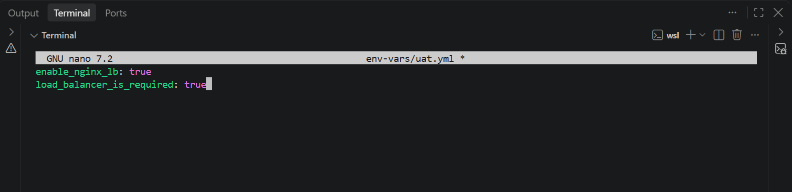

18. Update the inventory for the uat environment. 

```bash
nano inventory/uat.yml

---
uat-webservers:
  hosts:
    172.31.64.220:
      ansible_ssh_user: ec2-user
    172.31.64.236:
      ansible_ssh_user: ec2-user

lb:
  hosts:
    172.31.78.230:
      ansible_ssh_user: ubuntu
```
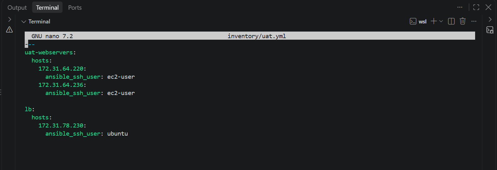
19. Before running the playbook, confirm that Ansible can reach all hosts in the inventory:

```bash
ansible all -i inventory/uat.yml -m ping
```
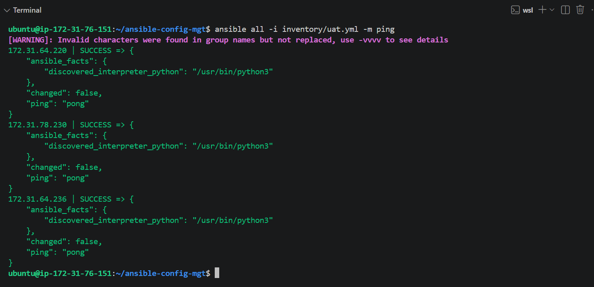

20. Run Ansible against the UAT environment to test the setup.

```bash
ansible-playbook -i inventory/uat.yml playbooks/site.yml
```
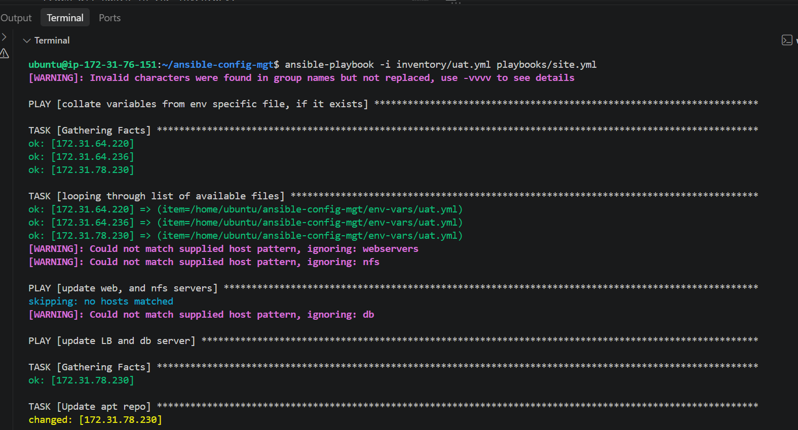
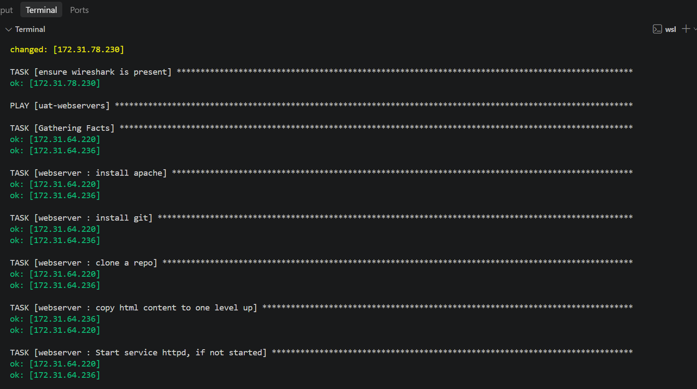
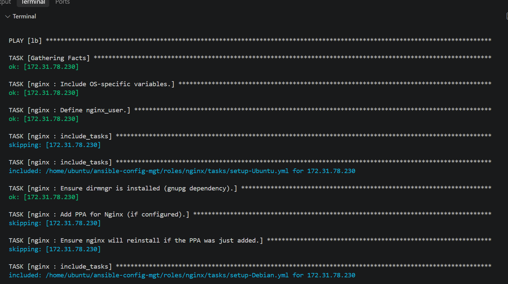
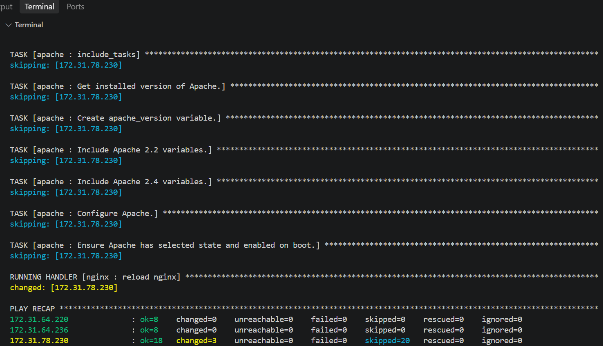

21. Confirm Nginx is running on the load balancer:
```bash
ssh ubuntu@172.31.78.230 "systemctl status nginx --no-pager"
```
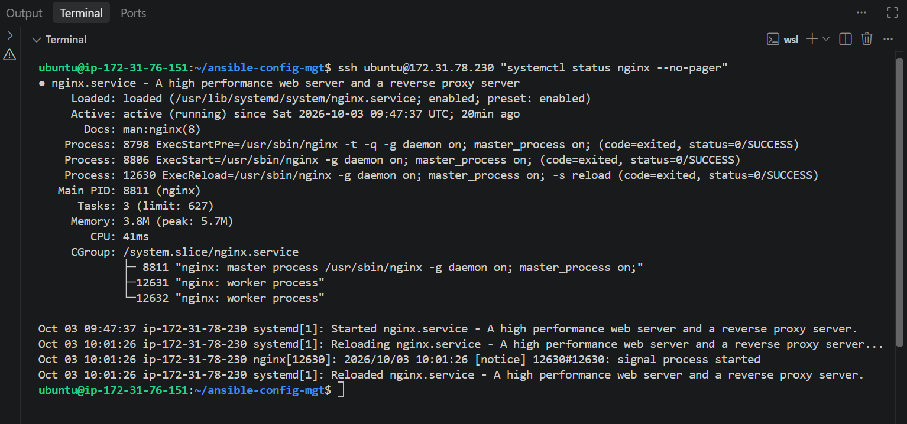


## Conclusion

This project introduced dynamic assignments and community roles into the Ansible setup. Environment-specific variables are loaded with `include_vars`, and Nginx and Apache roles can be switched on per environment through variables. For UAT, Nginx was activated, the playbook ran without failures, and the `nginx` service was confirmed running on the load balancer, while Apache stayed disabled.

